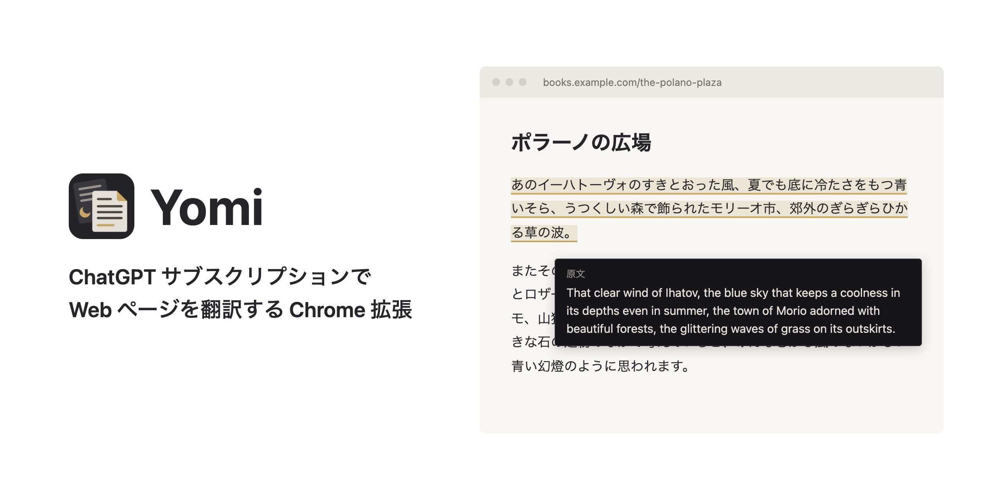

# Yomi

ChatGPT サブスクリプション（[Sign in with ChatGPT](https://developers.openai.com/siwc/token-sharing-open-source)）で Web ページを翻訳する Chrome 拡張。

## 機能

- **ページ全体の翻訳**: スクロールやページの変化に合わせて、見えている部分から順に訳す。
- **翻訳の提案と自動翻訳**: 翻訳先と違う言語のページを開くと翻訳するか尋ねる。サイトごとに「常に翻訳」を登録すると、開いただけで訳す。翻訳中のタブでリンクをたどると、移った先のページも続けて訳す。
- **原文表示**: 訳文にホバーすると原文を表示する。ページ全体の原文 / 訳文も切り替えられる。
- **選択テキストの翻訳**: 選択したテキストをその場で訳す。
- **キャッシュ**: 一度訳したページは再訪問やリロードで訳し直さない。

ショートカット: `Alt+T` 翻訳 / 停止（選択中は選択範囲を翻訳）、`Alt+O` 原文 / 訳文の切り替え

## 導入

1. [Releases](https://github.com/shun-shobon/yomi/releases) から最新の `*-chrome.zip` をダウンロードして展開する。
2. Chrome で `chrome://extensions` を開き、右上の「デベロッパー モード」をオンにする。
3. 「パッケージ化されていない拡張機能を読み込む」から展開したフォルダを選ぶ。
4. 拡張のポップアップから「ChatGPT でサインイン」を押し、開いたタブでアクセスを許可する。

更新するときは新しい zip を同じフォルダに展開し直し、`chrome://extensions` で再読み込みする。
